# Attack Surface Management (ASM) Pipeline

A home-lab pipeline that discovers assets, scans them for vulnerabilities, prioritizes
the findings using real exploitability data, and tracks remediation to closure through
Jira. Built as a portfolio project for an Attack Surface Management security engineering
role.


> **Scope and safety:** every scan in this project targets only machines I own, on an
> isolated virtual network that cannot reach the internet or any third-party system.
> See [Safety and scope](#safety-and-scope).

---

## What it does

The pipeline turns raw scanner output into an owned, prioritized, tracked remediation
workflow:

1. **Discover** live hosts and their services with Nmap.
2. **Scan** those hosts for vulnerabilities with OpenVAS (Greenbone), driven through its
   API — unauthenticated against a Linux target, and credentialed (SMB) against a
   Windows target.
3. **Normalize** both Nmap and OpenVAS output into a single SQLite database, so later
   steps never care which tool produced the data.
4. **Enrich** findings with two exploitability signals: the **CISA Known Exploited
   Vulnerabilities (KEV)** catalog and the **FIRST EPSS** exploitation-probability score.
5. **Prioritize** each finding into P1–P4 using CVSS severity, KEV, and EPSS, then assign
   a mock owner and an SLA due date.
6. **Report** everything as a self-contained HTML page.
7. **Track remediation** by opening Jira tickets (grouped by affected service), and
   **closing them automatically** once a rescan confirms the finding is gone.
8. **Verify** the code with pytest and GitHub Actions CI.

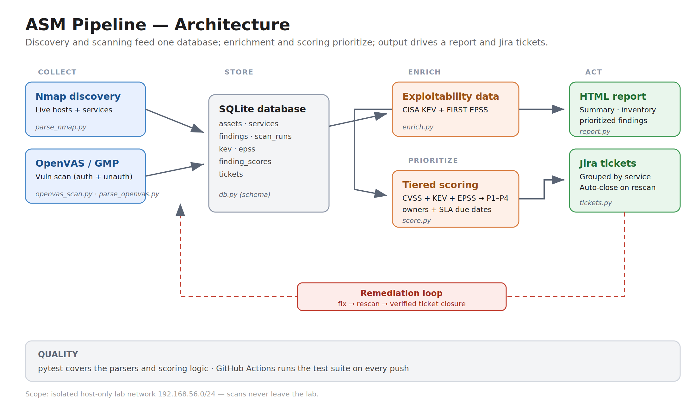
*End-to-end flow: discovery and scanning feed a SQLite database, enrichment and scoring
prioritize the findings, and the output drives an HTML report and Jira tickets.*

---

## Why these choices

This project is deliberately opinionated, and each decision maps to how attack surface
management is done in practice:

- **Exploitability, not just severity.** A CVSS score says how bad a vulnerability is
  *if* exploited. KEV says whether it *is* being exploited in the real world, and EPSS
  estimates how *likely* near-term exploitation is. Combining all three ranks an actively
  exploited flaw above a theoretically-worse one that nobody is attacking.
- **Normalization across scanners.** Findings from different tools are stored in one
  common format. Real teams run more than one scanner (the role that inspired this names
  both Nessus and Qualys), so the pipeline is built to merge them rather than depend on
  one vendor.
- **Remediation is the point.** Finding vulnerabilities is the easy half. The pipeline
  closes the loop: ticket → fix → rescan → verified closure, which is what "tracking
  remediation with owners" actually means.
- **Explainable priorities.** Every finding carries a plain-English reason
  (e.g. *"CVSS 9.8; 3 CVEs in CISA KEV, ransomware use known; max EPSS 0.84"*), so an
  asset owner can see *why* something is urgent.

---

## Architecture

| Stage | Script | Output |
| --- | --- | --- |
| Discovery | `src/asm/parse_nmap.py` | `assets`, `services` tables |
| Vulnerability scan | `src/asm/openvas_scan.py` | OpenVAS XML report |
| Finding ingest | `src/asm/parse_openvas.py` | `findings`, `scan_runs` tables |
| Enrichment | `src/asm/enrich.py` | `kev`, `epss` tables |
| Scoring | `src/asm/score.py` | `finding_scores` table |
| Reporting | `src/asm/report.py` | HTML report |
| Remediation | `src/asm/tickets.py` | `tickets` table + Jira issues |
| Schema/connection | `src/asm/db.py` | SQLite database |

The lab itself: a VirtualBox host-only network (`192.168.56.0/24`) with a Kali scanner
and two deliberately imperfect targets.

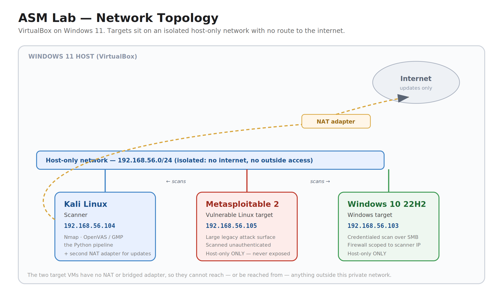
*Isolated host-only network. The Kali scanner has a second NAT adapter for updates; the
targets have none and cannot leave the lab.*

| Host | Role | Notes |
| --- | --- | --- |
| Kali Linux (`192.168.56.104`) | Scanner | Nmap, OpenVAS/GVM, the Python pipeline |
| Metasploitable 2 (`192.168.56.105`) | Vulnerable Linux target | Large legacy attack surface |
| Windows 10 22H2 (`192.168.56.103`) | Windows target | Scanned with credentials over SMB |

---

## Results from a real run

> Numbers below are from my own lab run and will differ on another setup. Screenshots are
> in `docs/`.

### Discovery (Nmap)

A host-discovery sweep found four live hosts, including one I had not deliberately
deployed (VirtualBox's own DHCP service) — a small example of discovery surfacing an asset
that wasn't in any inventory. The Windows host answered no pings yet was still found via
ARP.

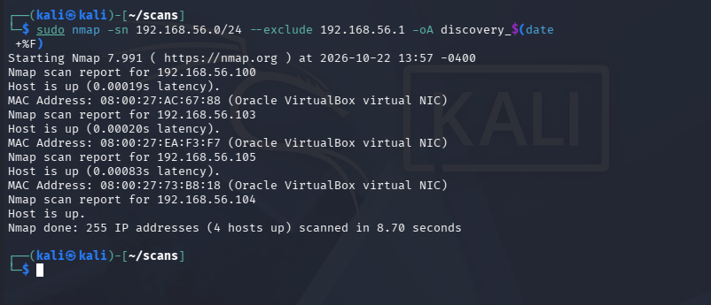

A service/OS scan then fingerprinted what was running on each host. Version data (for
example *vsftpd 2.3.4*) is what later links a service to known vulnerabilities.

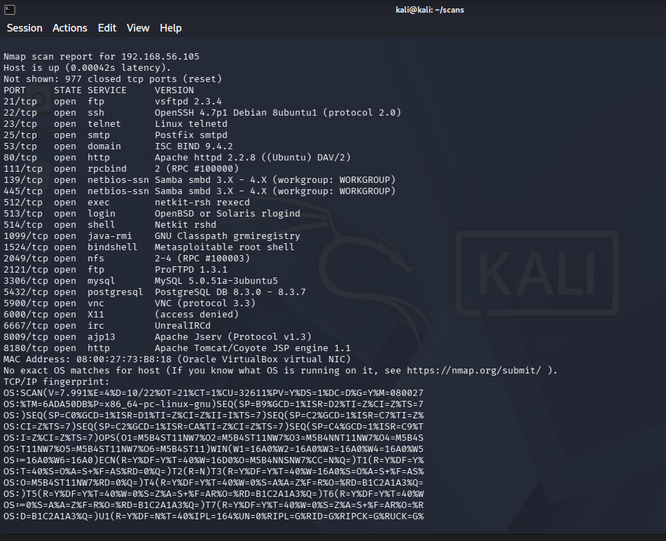

The parser loads that output into the `assets` and `services` tables, so the rest of the
pipeline works from structured data instead of scan text.

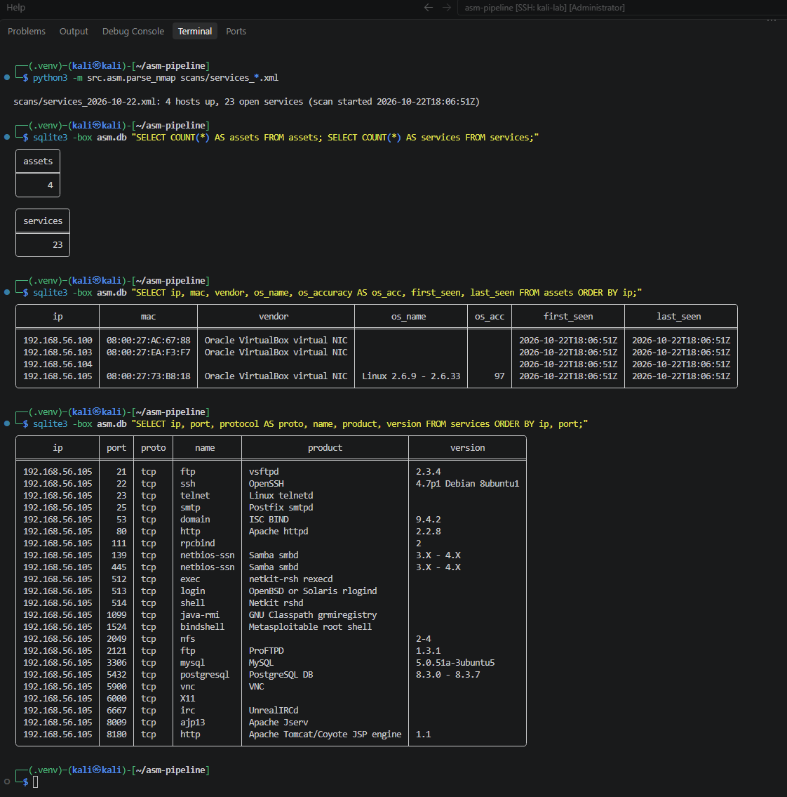

### Vulnerability scanning

Metasploitable produced dozens of findings from an **unauthenticated** scan.

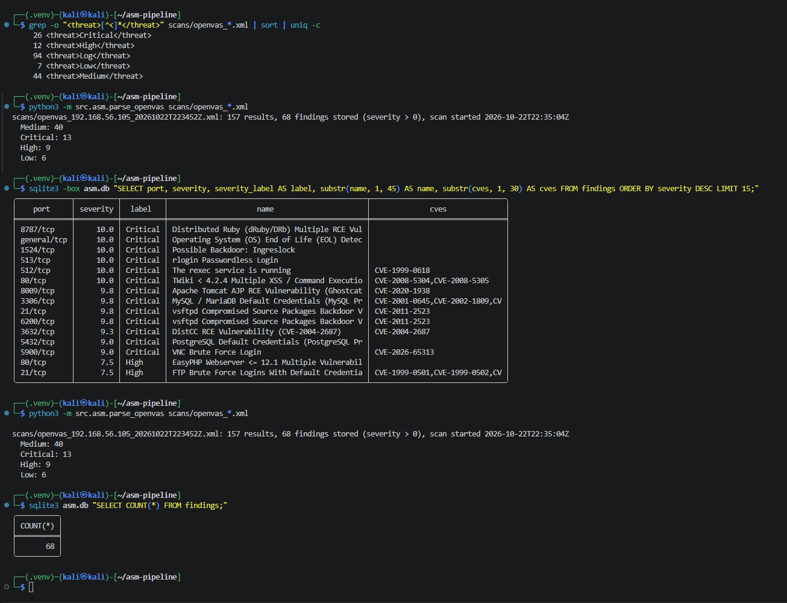

I also ran **Nessus Essentials** against the same host, to show the pipeline isn't tied to
one scanner and to compare coverage — real teams routinely run more than one.

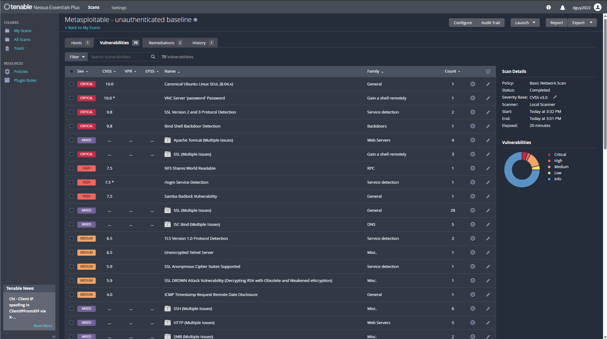

The Windows host looked nearly empty from the network (its firewall dropped everything),
but a **credentialed** scan over SMB revealed many missing-patch findings from the inside —
a concrete demonstration of why authenticated scanning matters. The result names confirm
the scanner actually logged in (*"SMB Login Successful"*) before trusting the presence or
absence of findings.

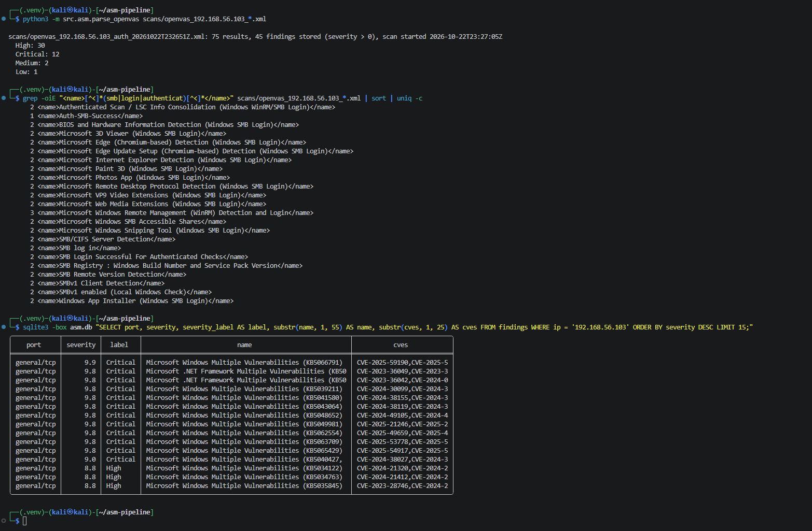

### Enrichment

KEV and EPSS add real-world context. For example, the vsftpd backdoor is not in KEV but
has a very high EPSS, while some high-EPSS TLS flaws have low impact and correctly stay out
of the top tier. Several Windows findings are in KEV with **known ransomware use**.

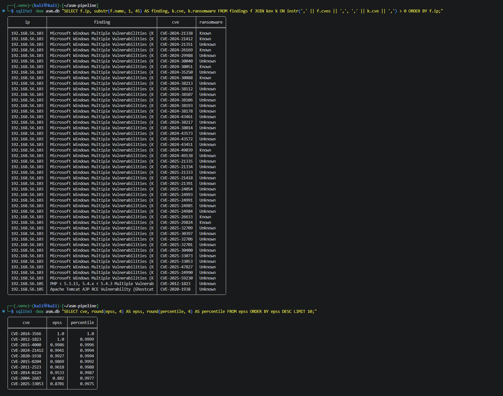

### Prioritization

After scoring, the top two risks on the network were an open root shell (Ingreslock) and a
passwordless login (rlogin) — both findings with *no CVE*, which pure CVSS/KEV/EPSS ranking
would have buried. A keyword rule for backdoors and default/passwordless access floats them
to the top, and every finding carries a plain-English reason.

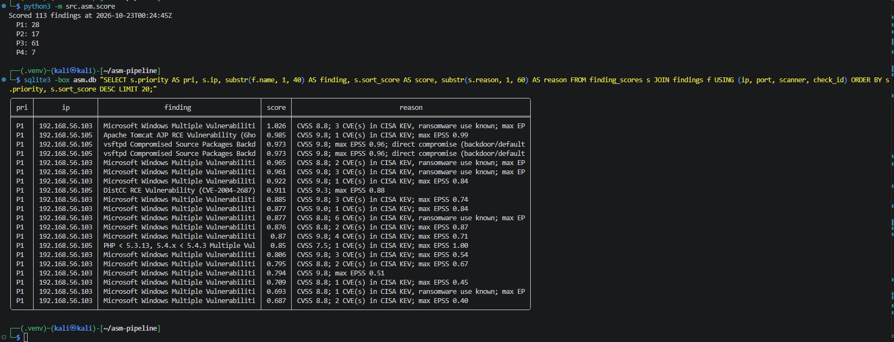

Each finding is also assigned a mock owner and an SLA due date, giving a per-team workload
view — the kind of rollup a remediation manager would act on.

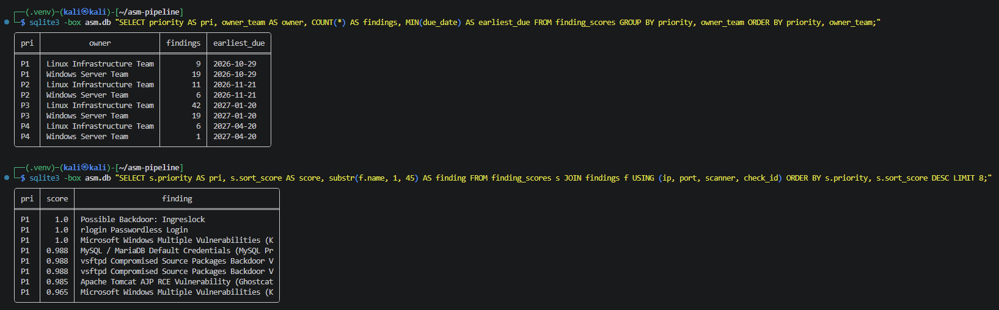

### HTML report

A single self-contained page: summary cards, workload by owner, asset inventory, and
prioritized findings with due dates and SLA status.

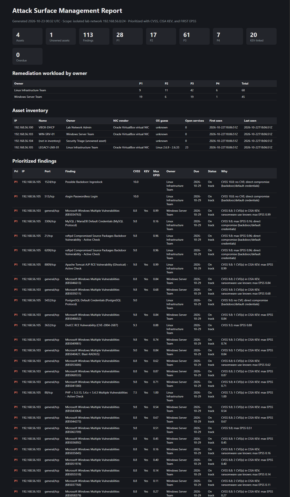

### Remediation loop

Tickets are grouped by affected service and opened in Jira with an owner, priority, and due
date.

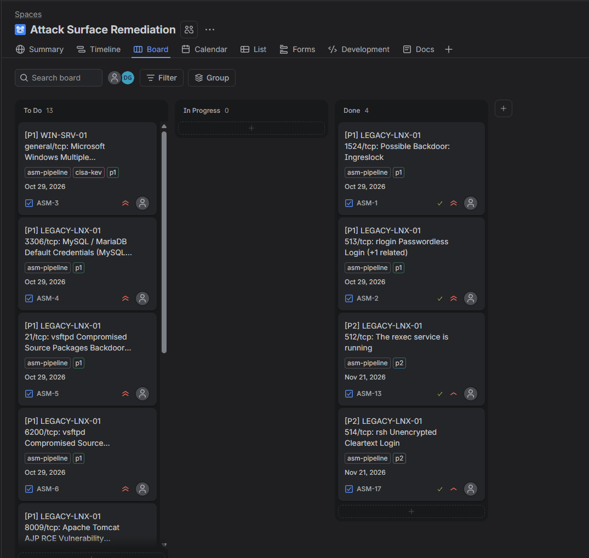

After fixing several findings and rescanning, the pipeline closed the corresponding tickets
automatically. The `--close` step previews with a dry run first, then closes verified
tickets and comments on each with the rescan evidence.

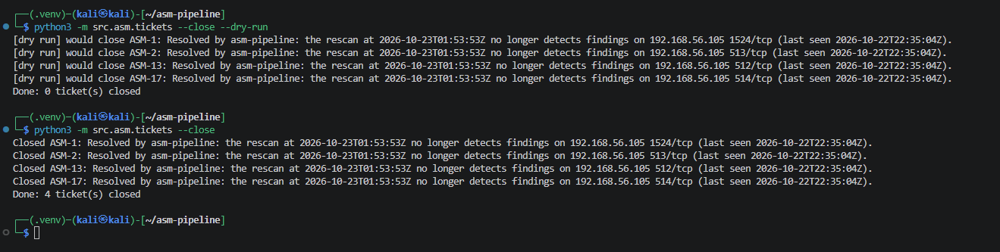

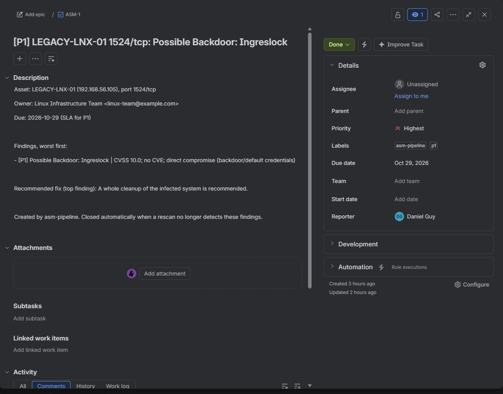

The fix is also confirmed independently of the pipeline — an Nmap check from the scanner's
point of view showing the ports are now closed.

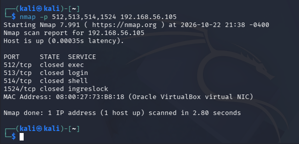

A realistic edge case: the Windows target is Windows 10, which has reached end of support.
Patching closed most of its findings, but the "end of life" finding cannot be fixed by
patching — the real remediation is an upgrade or a documented risk-acceptance decision.
The pipeline correctly keeps that ticket open rather than pretending it's resolved.

### Quality

The parsers and scoring logic are covered by pytest, which runs on every push via GitHub
Actions.

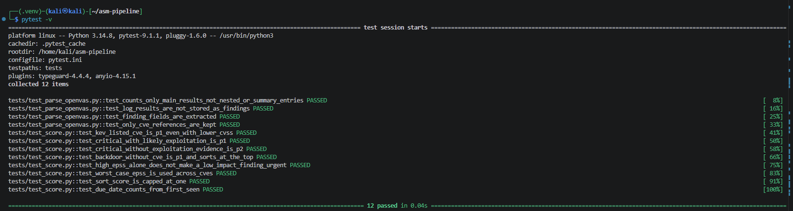
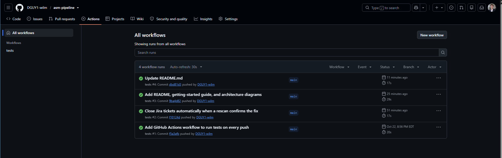

---

## Tech stack

- **Scanning:** Nmap, OpenVAS / Greenbone Vulnerability Management (GMP API), Nessus
  Essentials (used for comparison)
- **Language:** Python 3 (standard library plus `requests`, `python-gvm`, `lxml`, `PyYAML`)
- **Storage:** SQLite
- **Enrichment:** CISA KEV catalog, FIRST EPSS API
- **Ticketing:** Jira Cloud REST API
- **Quality:** pytest, GitHub Actions
- **Lab:** VirtualBox on Windows 11 (Kali, Metasploitable 2, Windows 10)

---

## Running it

See **[GETTING_STARTED.md](GETTING_STARTED.md)** for a full, beginner-friendly walkthrough
of building the lab and running every step.

Quick version, once the lab and a Python virtual environment are set up:

```bash
# 1. Discover hosts and services
sudo nmap -sn 192.168.56.0/24 --exclude 192.168.56.1 -oA scans/discovery_$(date +%F)
# (build live_hosts.txt, then:)
sudo nmap -sV -O --top-ports 1000 -iL live_hosts.txt -oA scans/services_$(date +%F)
python3 -m src.asm.parse_nmap scans/services_*.xml

# 2. Vulnerability scan (OpenVAS must be running)
python3 -m src.asm.openvas_scan 192.168.56.105
python3 -m src.asm.parse_openvas scans/openvas_*.xml

# 3. Enrich, score, report
python3 -m src.asm.enrich
python3 -m src.asm.score
python3 -m src.asm.report

# 4. Remediation (needs JIRA_SITE, JIRA_EMAIL, JIRA_TOKEN exported)
python3 -m src.asm.tickets --dry-run
python3 -m src.asm.tickets --project ASM
# ...fix things, rescan, then:
python3 -m src.asm.tickets --close
```

Configuration lives in `config/owners.yaml` (mock asset owners) and `config/sla.yaml`
(days-to-remediate per priority).

---

## Safety and scope

- **Only systems I own.** Every target is a VM I built, on a VirtualBox **host-only**
  network that has no route to the internet or to any other network. The scan script
  includes a scope guard that refuses any target outside `192.168.56.0/24`.
- **Intentionally vulnerable VMs stay isolated.** Metasploitable is never attached to a
  network that can reach the outside world.
- **Secrets are never committed.** API tokens and passwords are read from environment
  variables or secure prompts, never hard-coded. Raw scan output, the database, and
  generated reports are git-ignored because they describe real weaknesses.

---

## Known limitations and future work

I kept a running list of honest limitations rather than hiding them:

- **Open-finding definition.** Scoring and the report currently include findings from the
  most recent run of each host, but don't yet formally exclude findings that a newer scan
  no longer detects. A database view scoped to each host's latest scan would fix this.
- **Failed-login detection.** For credentialed scans, a *failed* login makes findings
  disappear the same way a *fix* does. The pipeline checks for "SMB Login Successful"
  before closing Windows tickets; automating that check is a planned improvement.
- **Grouping granularity.** Tickets are grouped by host and port, so one root cause that
  appears on two ports (e.g. the vsftpd backdoor) becomes two tickets. Grouping by CVE or
  root cause would be more precise.
- **CVE storage.** CVEs are stored as a comma-separated string rather than a normalized
  table, which keeps the code simple but makes some queries awkward.
- **Dashboards.** This project outputs an HTML report; a Splunk dashboard (open findings
  by severity, time-to-remediate, new assets) is a natural next step. I've built Splunk
  and Microsoft Sentinel dashboards in separate projects, and this pipeline's data model
  (findings, scores, and tickets with timestamps) is designed to feed one.
- **External discovery.** Certificate-transparency (crt.sh) and DNS enumeration for a
  domain I own would extend discovery beyond the internal network.

---

## A note on AI use

I used an AI assistant as a pair-programming mentor throughout this project. It explained
concepts, generated and reviewed code, and helped me debug. I ran, tested, and verified
everything myself, debugged the real-world failures (there were many), and made the design
decisions. `AI_USAGE.md` records what was AI-generated versus what I wrote and did myself.

